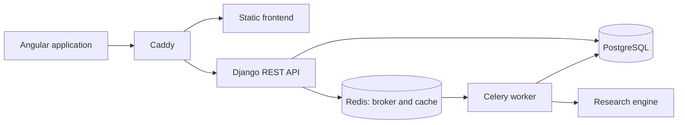

# Currency Safety Net

Currency Safety Net helps households understand how their income, essential
expenses and savings interact across KZT, USD and EUR. It combines a personal
financial overview with simulations of currency-related shortfalls.

[Website](https://currencysafety.com) ·
[Research preprint](https://papers.ssrn.com/sol3/papers.cfm?abstract_id=7591999)

## Features

- **Household assessment:** income, expenses and reserves by currency, with an
  overview of spending and initial reserve coverage.
- **Personal simulations:** compare the current reserve mix with the allocation
  selected by the model for the same scenario. Availability is controlled by
  the server configuration.
- **Research calculator:** explore the four household profiles from the study.
- **Buffer sensitivity:** compare reserves covering 1, 3, 6 and 12 months of
  initial essential expenses, and find the first tested level meeting a chosen target.
- **Research results:** compare saved scenarios and create printable reports.

The model minimizes CVaR95: the average cumulative unpaid expenses in the worst
5% of simulated paths. It does not maximize investment returns or forecast
exchange rates. Other risk and reserve metrics help explain the result.

## Architecture

The API validates submissions, stores a job and queues the calculation after
the database transaction commits. Celery runs the numerical model and saves
the result. The browser polls the job endpoint until it finishes. Equivalent
requests can reuse an existing result.

The production stack uses PostgreSQL, Redis and Caddy. Local development can
use SQLite and Angular's API proxy. The pilot deployment runs both task queues
on one worker; the full deployment separates ordinary and buffer-sensitivity
tasks. Worker concurrency is one in either configuration.

| Directory                  | Responsibility                                                |
| -------------------------- | ------------------------------------------------------------- |
| `frontend/src/app/`        | Angular pages, components, form state and API clients         |
| `backend/calculations/`    | REST endpoints, job persistence, validation and tasks         |
| `backend/research_engine/` | Cash flows, FX simulation, allocation search and risk metrics |
| `backend/project/`         | Django, Celery and environment configuration                  |
| `deploy/`                  | Container images, Compose profiles and Caddy configuration    |
| `scripts/`                 | Reusable verification and performance tools                   |
| `docs/`                    | Development, model, API and operations documentation          |

The frontend uses Angular and TypeScript. The backend uses Django REST
Framework and Celery; numerical calculations use NumPy, pandas, SciPy and
statsmodels. Exact dependencies are recorded in the package lockfile and
`backend/requirements.txt`.

## Model scope

Simulations use historical FX data, 10,000 paths and a fixed seed. The research
calculator retains the study's four profiles; custom households are direct
model evaluations rather than additional published validation cases.

Income remaining after entered essential expenses stays in simulated savings.
Planned contributions and unentered spending are not modeled. Results describe
the selected assumptions, not a guarantee or an instruction to trade currencies.

## Documentation

- [Local development and tests](docs/development.md)
- [Frontend structure](frontend/README.md)
- [Model methodology](docs/product/resilience-and-buffer-methodology.md)
- [Personal simulation API](docs/product/personalized-simulation-contract.md)
- [Buffer sensitivity API](docs/product/buffer-sensitivity-batch-design.md)
- [Deployment](deploy/README.md)
- [Operations](docs/deployment/pilot-operations-runbook.md)
