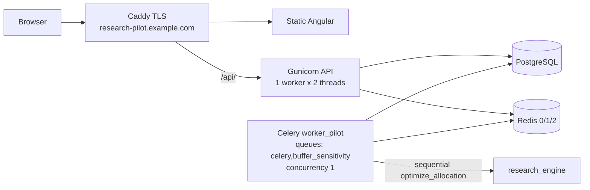

# Low-Resource Research Pilot Profile (Phase 4B.1)

**Status:** packaging and documentation only — no VPS, DNS, or expensive benchmarks executed in this phase.  
**Placeholder domain:** `research-pilot.example.com` (international example only; not `.kz`; not a real registration).  
**Same-origin:** `https://research-pilot.example.com/` and `https://research-pilot.example.com/api/`

This profile targets a **4 GB RAM / 2–4 shared vCPU / ~80 GB SSD** single VPS for a very low-traffic university admissions demonstration. It does **not** guarantee that 4 GB is sufficient until a deployment-host benchmark passes.

The full Phase 4B profile (**≈8 GB**, dedicated `worker_opt` + `worker_buffer`) remains available.

Scientific model behavior, paths, seed, grids, validation, and task limits are unchanged.

---

## 1. Two deployment modes

| Mode | Host candidate | Celery | Gunicorn | Compose |
|---|---|---|---|---|
| **Low-resource research pilot** | ≈4 GB RAM | One `worker_pilot` on `celery,buffer_sensitivity` | 1 worker × 2 threads | `--profile pilot` + `compose.low-resource.yaml` |
| **Full pilot/production candidate** | ≥8 GB RAM | `worker_opt` + `worker_buffer` | 2 workers × 2 threads | `--profile full` only |

**Never** enable `--profile full` and `--profile pilot` together (would start three workers and risk concurrent scientific peaks).

Switching modes does not require rebuilding `research_engine` or changing scientific code.

---

## 2. Topology



**Sequential rule:** with concurrency 1 and a single process consuming both queues, an ordinary optimization task and a buffer-sensitivity task never run at the same time.

Task routing, soft/hard limits, leases, retries, fingerprinting, and result validation remain exactly as implemented in Phase 4B / 3C.

---

## 3. Exact combined Celery command

```text
celery -A project worker --loglevel=INFO --hostname=pilot@%h \
  --queues=celery,buffer_sensitivity \
  --concurrency=1 --prefetch-multiplier=1 --max-tasks-per-child=1
```

---

## 4. Commands (from repository root)

Set `DEPLOY=deploy` for brevity. Copy env first:

```bash
cp deploy/.env.pilot.example deploy/.env.pilot
# edit deploy/.env.pilot — never commit secrets
```

### Validate resolved Compose (no containers required for `config`)

```bash
docker compose --env-file deploy/.env.pilot \
  -f deploy/compose.production.yaml \
  -f deploy/compose.low-resource.yaml \
  --profile pilot config
```

Expect services including: `postgres`, `redis`, `api`, `worker_pilot`, `proxy` (and `migrate`/`cleanup` only with `--profile ops`).  
Expect **no** `worker_opt` / `worker_buffer` unless `--profile full` is also set (do not do that).

### Build

```bash
docker compose --env-file deploy/.env.pilot \
  -f deploy/compose.production.yaml \
  -f deploy/compose.low-resource.yaml \
  --profile pilot build
```

### Migrate (one-off)

```bash
docker compose --env-file deploy/.env.pilot \
  -f deploy/compose.production.yaml \
  -f deploy/compose.low-resource.yaml \
  --profile ops run --rm migrate
```

### Start / stop / status / logs

```bash
docker compose --env-file deploy/.env.pilot \
  -f deploy/compose.production.yaml \
  -f deploy/compose.low-resource.yaml \
  --profile pilot up -d

docker compose --env-file deploy/.env.pilot \
  -f deploy/compose.production.yaml \
  -f deploy/compose.low-resource.yaml \
  --profile pilot ps

docker compose --env-file deploy/.env.pilot \
  -f deploy/compose.production.yaml \
  -f deploy/compose.low-resource.yaml \
  --profile pilot logs --tail=200 api worker_pilot proxy

docker compose --env-file deploy/.env.pilot \
  -f deploy/compose.production.yaml \
  -f deploy/compose.low-resource.yaml \
  --profile pilot down
```

Do not log or paste financial payloads, secrets, or database URLs.

### Retention cleanup (daily)

```bash
docker compose --env-file deploy/.env.pilot \
  -f deploy/compose.production.yaml \
  -f deploy/compose.low-resource.yaml \
  --profile ops run --rm cleanup
```

### Full 8 GB mode (contrast)

```bash
cp deploy/.env.production.example deploy/.env.production
docker compose --env-file deploy/.env.production \
  -f deploy/compose.production.yaml \
  --profile full up -d
```

---

## 5. Gunicorn pilot configuration

| Setting | Low-resource pilot | Full profile default |
|---|---|---|
| Workers | **1** | **2** |
| Threads | **2** | **2** |
| Timeout | 60 s | 60 s |

**Why 1 API worker is acceptable for this research pilot:** traffic is expected to be tiny (committee demo). The HTTP process never runs `optimize_allocation`; it only enqueues and polls. One sync worker with two threads is enough for health, metadata, and job polling while the Celery process runs science. This is **not** a claim about production scale.

Applied only via `compose.low-resource.yaml` / env placeholders — Django request/view behavior is unchanged.

---

## 6. Submissions and throttles

Preserved application defaults (also in `.env.pilot.example`):

| Scope | Rate |
|---|---|
| Ordinary optimization submit | `3/hour` |
| Buffer sensitivity submit | `2/hour` |
| Job poll | `120/min` |
| Model metadata | `60/min` |

Both `OPTIMIZATION_SUBMISSIONS_ENABLED` and `BUFFER_SENSITIVITY_SUBMISSIONS_ENABLED` default to **True** in the pilot example. Freeze switches remain for emergencies only — not normal pilot operation.

Fingerprint deduplication, caching, pending guards, and queue safety are unchanged.

---

## 7. Resource behavior on a 4 GB host

Measured scientific peaks (Phase 3B artifact): up to about **1.14–1.19 GiB** RSS per optimization process; batch wall times up to about **467 s** on the measurement host. See `docs/product/benchmarks/buffer-sensitivity-phase3b.json`.

On 4 GB:

- Only **one** scientific task at a time (`worker_pilot`).
- PostgreSQL and Redis stay up while the worker runs.
- Do **not** set a worker cgroup limit below the measured ~1.2 GiB peak (pilot Compose omits a hard `mem_limit`).
- **Swap is not usable application capacity.** Recommend **2–4 GB host swap only as emergency OOM protection**. Sustained swap usage **fails** the deployment benchmark.
- Do not invent Redis/PostgreSQL memory caps without host evidence.
- Persist PostgreSQL volume; keep Postgres/Redis on the private compose network; expose only Caddy 80/443.

**4 GB is a candidate size, not a certified size**, until Phase 4C benchmarks pass.

---

## 8. Phase 4C deployment-host benchmark gate

Run on the **actual** pilot VPS after deploy. Do **not** run these expensive jobs during Phase 4B.1 packaging.

### Procedure

1. Confirm `GET /api/v1/ready/` at idle.
2. Run **one** ordinary P2 / 3-year optimization (production API).
3. Run **one** P2 / 3-year buffer-sensitivity batch.
4. Record peak container and host memory (API, worker, Postgres, Redis, host).
5. Record wall-clock durations for (2) and (3).
6. Record swap used / swap-in rate during jobs.
7. While the worker is busy, confirm `/api/v1/health/`, `/api/v1/ready/`, and job polling remain responsive.
8. Submit an ordinary job and a batch job close together; confirm **sequential** execution (never concurrent science).
9. Restart `worker_pilot` after a completed task; confirm recovery/lease behavior.
10. Repeat an identical POST; confirm cached reuse of the same fingerprint/result.

### Acceptance

- No OOM kill; no memory-pressure container restart.
- No sustained swap usage.
- API and polling remain responsive.
- Tasks remain sequential.
- Results pass existing validation; canonical model outputs unchanged.
- Cached repeat returns the same job/result.
- Review soft/hard limits and leases against **measured** host runtimes (do not invent new limits beforehand).

### If the host fails

1. Increase VPS resources to at least the **full ≈8 GB** profile with dedicated workers; **or**
2. Temporarily use existing submission freeze switches.

**Never** reduce simulation paths, seed, grid, or scientific computation to “fit” the host.

---

## 9. Optional demonstration cache warming

Shortly before an admissions demo (still within the **7-day** retention window), operators may run a **small** set of **real** production scenarios so repeats hit fingerprint cache.

Rules:

- No fabricated/static substitute results.
- No canonical values embedded in the frontend.
- No optimizer bypass.
- Verify succeeded status and provenance on returned jobs.
- Correctness must not depend on warming.

Do **not** run this procedure in Phase 4B.1.

---

## 10. Upgrade path

1. Keep the same images and scientific package.
2. Stop pilot stack (`--profile pilot down`).
3. Use `deploy/.env.production` (or equivalent) with the real host domain.
4. Start `--profile full` (dedicated workers; Gunicorn 2×2).
5. Re-run deployment-host benchmarks on the larger machine.

---

## 11. Privacy (unchanged)

- Seven-day terminal-job retention.
- Analytics disabled.
- Research-pilot positioning.
- noindex for capability URLs.
- Safe API errors; no financial payload logging.

---

## 12. Related files

- `deploy/compose.production.yaml`
- `deploy/compose.low-resource.yaml`
- `deploy/.env.pilot.example`
- `deploy/README.md`
- `docs/deployment/pilot-operations-runbook.md`
- `docs/deployment/pilot-go-live-checklist.md`
