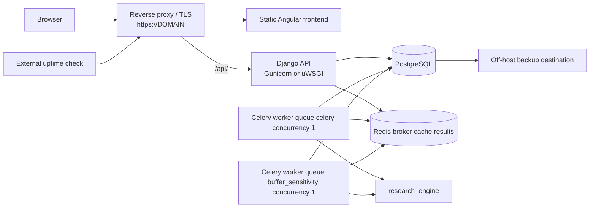
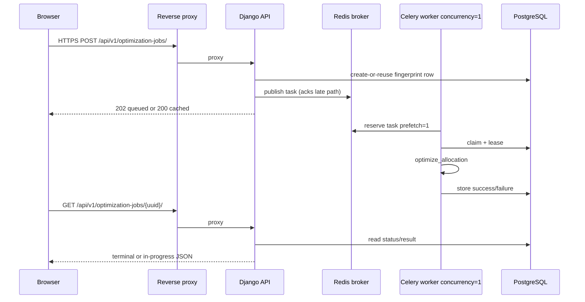

## Phase 4B implementation note

Repository packaging now includes:

- `DATABASE_URL` PostgreSQL selection when `DEBUG=False`
- `REDIS_CACHE_URL` shared throttle cache (distinct from broker `/0` and results `/1`)
- `OPTIMIZATION_SUBMISSIONS_ENABLED` freeze switch
- `GET /api/v1/ready/` readiness
- `JOB_RETENTION_DAYS` + `cleanup_expired_jobs`
- `deploy/compose.production.yaml` single-VPS topology
- Research calculator at `/research/calculator`

Live DNS, secrets, migrate, and deployment-host benchmarks remain Phase 4C host work.

---

This document specifies the **recommended limited research pilot** topology: a single appropriately sized VPS with same-origin TLS reverse proxy. No DNS changes or deployments are performed here.

---

## 1. Recommended service topology

### 1.1 Mermaid — deployment overview

### 1.2 Mermaid — request and job path

### 1.3 Queue and concurrency assumptions

| Worker hostname (example) | Queues consumed | Concurrency | Prefetch | Max tasks/child |
|---|---|---:|---:|---:|
| `opt@host` | `celery` | **1** | **1** | **1** |
| `buffer@host` | `buffer_sensitivity` | **1** | **1** | **1** |

These match root `README.md` and `CELERY_WORKER_*` defaults in `backend/project/settings.py`. Do not raise concurrency without new deployment RSS measurements (Phase 3B peaks ≈ **1.14–1.19 GiB** RSS).

Task routes: `calculations.run_buffer_sensitivity_job` → queue `buffer_sensitivity`. Ordinary optimization uses the default queue.

---

## 2. Network boundaries

| Zone | Contains | Exposure |
|---|---|---|
| Public | Reverse proxy :443/:80 | Browser only |
| App private | Django, Celery workers | No public ports |
| Data private | PostgreSQL, Redis | Localhost or private network only; **never** public bind |
| Ops | SSH/VPN admin access | Key-based; restrict admin UI |

Local `compose.yaml` already binds Redis to `127.0.0.1` — retain that posture in production (or private VPC equivalent).

---

## 3. Domain and TLS design (placeholder domain)

**Placeholder:** `https://<domain>/`

### 3.1 Preferred: same-origin API

| URL | Role |
|---|---|
| `https://<domain>/` | Angular static assets + client routes |
| `https://<domain>/api/` | Reverse-proxied Django `/api/` |

**Why preferred:** Frontend already uses relative `/api/v1` URLs. Same-origin avoids CORS configuration errors, simplifies cookies if admin sessions are used later, and matches the local proxy mental model (`proxy.conf.json`).

### 3.2 Alternative: API subdomain

| URL | Role |
|---|---|
| `https://<domain>/` | Frontend |
| `https://api.<domain>/` | Django |

Requires exact `CORS_ALLOWED_ORIGINS=https://<domain>` (and preview origins if any), CSRF trusted-origin consideration for session/admin, and duplicate TLS cert coverage. **Not preferred** for the pilot unless a platform constraint forces split hosting.

### 3.3 DNS records (future; not applied in Phase 4A)

| Name | Type | Target |
|---|---|---|
| `<domain>` | A/AAAA | VPS public address |
| `www.<domain>` | CNAME or A/AAAA | Canonical host or redirect target |
| Optional `api.<domain>` | A/AAAA | Only if subdomain design chosen |

Exact TTL and DNS hoster: **unknown** until selected.

### 3.4 TLS, redirects, canonical host

1. Terminate TLS at reverse proxy (certificate via ACME or platform cert — provider-specific; **unknown** until chosen).
2. Redirect HTTP → HTTPS.
3. Redirect `www` → apex or apex → `www` (pick one canonical host).
4. Django: `DEBUG=False`; `ALLOWED_HOSTS` exact hosts only (no `*` for pilot).
5. Behind proxy, set `SECURE_PROXY_SSL_HEADER` **only** if the proxy strips client-supplied `X-Forwarded-Proto` and sets it correctly (Django deployment checklist warning).
6. Enable `SECURE_SSL_REDIRECT`, `SESSION_COOKIE_SECURE`, `CSRF_COOKIE_SECURE` when HTTPS is live.
7. HSTS (`SECURE_HSTS_SECONDS`) only after HTTPS is verified stable (**RECOMMENDED DURING PILOT**, not day-zero if cert churn risk).

### 3.5 Rollback considerations

- Keep previous frontend asset bundle and previous API/worker image tags immutable.
- DNS TTL should be low enough during cutover for rollback (**value TBD by operator**).
- Do not rely on editing live containers by hand.

---

## 4. Database design — SQLite → PostgreSQL

**Do not execute migration in Phase 4A.**

### 4.1 Required settings (proposed production)

| Setting | Production intent |
|---|---|
| `ENGINE` | `django.db.backends.postgresql` |
| `NAME` / `USER` / `PASSWORD` / `HOST` / `PORT` | Via env (`DATABASE_URL` **proposed** or discrete vars) |
| Conn management | Prefer env-driven; consider `CONN_MAX_AGE` modest for worker+API processes |
| SSL | Require TLS to managed DB if off-host; local socket OK on single VPS |

`psycopg` (or `psycopg2`) is **not** in current `requirements.txt` — adding it is a **BLOCKER** code/dependency change for a later phase.

### 4.2 Migrations

1. Backup empty/new PostgreSQL.
2. `python manage.py migrate` against PostgreSQL using the same migration history (`0001`–`0003` under `calculations/migrations/`).
3. Do not copy SQLite production data as the pilot launch path unless a one-time verified dump/transform is approved (out of scope).

### 4.3 Backup / restore / retention

| Topic | Design |
|---|---|
| Backup | Nightly `pg_dump` (custom or SQL) to off-host storage; test restore monthly |
| Restore | New volume → restore dump → point API/workers at restored DSN → smoke tests |
| Retention of backups | Operator choice; recommend ≥ 7–30 days for pilot (**product/ops decision**) |
| Job row retention | Separate from backup retention — see privacy |

### 4.4 Failure / rollback

- Forward-only migrations preferred for pilot.
- Backward-incompatible migrations require expand/contract and a freeze window (`BUFFER_SENSITIVITY_SUBMISSIONS_ENABLED=False` plus proposed optimization freeze).
- SQLite must not remain the production engine.

---

## 5. Redis design

### 5.1 Current repository usage

| Use | Env / setting | Local default |
|---|---|---|
| Celery broker | `CELERY_BROKER_URL` | `redis://127.0.0.1:6379/0` |
| Celery results | `CELERY_RESULT_BACKEND` | `redis://127.0.0.1:6379/1` |
| DRF throttle cache | **unset** → Django default LocMemCache | Process-local |

`compose.yaml` enables Redis AOF (`--appendonly yes`).

### 5.2 Production approach

1. **Shared Redis-backed throttling (required):** configure Django `CACHES` with Redis (Django `RedisCache` or equivalent). DRF `AnonRateThrottle` stores rates in the cache backend ([DRF throttling docs](https://www.django-rest-framework.org/api-guide/throttling/)).
2. **Logical DB separation (recommended):** e.g. broker `/0`, results `/1`, cache/throttle `/2` — or separate instances if budget allows. Exact layout is operational, not scientifically constrained.
3. **Broker unavailability:** already returns `queue_unavailable` on publish failure with short broker timeouts.
4. **Queue depth / backpressure:** monitor `celery` and `buffer_sensitivity` lengths; alert thresholds **after** deployment measurement (do not invent numbers).
5. **Submission freeze:** buffer freeze exists; add optimization freeze (**proposed**).
6. **Duplicate expensive tasks:** unique `request_fingerprint` create-or-reuse already prevents duplicate compute for identical normalized requests.
7. **Worker loss:** leases + `ACKS_LATE` + `REJECT_ON_WORKER_LOST` + `max-tasks-per-child=1` support recovery; redelivery increments attempts.

### 5.3 Redis persistence expectations

- AOF/RDB reduces broker loss risk but is **not** a substitute for PostgreSQL durability of job rows.
- Treat Redis as durable-enough for queues; treat PostgreSQL as system of record for job state/results.

---

## 6. Worker design

| Topic | Pilot rule |
|---|---|
| Concurrency | **1** per worker process |
| Memory allowance | ≥ **2 GiB** RAM available to each worker process budget (README); host must support simultaneous peaks if both busy (~**4 GiB+** free for workers alone per README) |
| Time limits | Keep task-specific soft/hard/lease; re-validate on deployment hardware |
| Prefetch | 1 |
| Max tasks per child | 1 (mitigate RSS growth) |
| Separation | Never combine queues in production workers |

Code changes required before claiming production throttle safety: Redis `CACHES` wiring (**BLOCKER**/required). No scientific model changes.

---

## 7. Frontend static hosting on the VPS

1. Build with Node 24: `fnm exec --using=24 npm run build` (or equivalent) in `frontend/`.
2. Serve `frontend/dist/currency-safety-net-ui/browser` (or current Angular output path) as the site root.
3. SPA fallback: unknown paths → `index.html` except `/api/`.
4. Do not embed production hostnames in Angular code (already relative API).

---

## 8. Environment-variable matrix

Legend:

- **Class:** `secret` / `non-secret`
- **Startup fail:** whether process should refuse to start if missing/invalid in production
- **Proposed:** not present in repository today; required for pilot design

### 8.1 Existing variables (from `.env.example` + `settings.py`)

| Variable | Service | Development | Production requirement | Class | Safe validation | Startup fail |
|---|---|---|---|---|---|---|
| `DEBUG` | Django | `True` | Must be `False` | non-secret | boolean | Yes if `True` in prod policy |
| `DJANGO_SECRET_KEY` | Django | Dev fallback allowed | Unique strong secret; not fallback | secret | ≠ `dev-only-not-for-production-change-me` when `DEBUG=False` (already enforced) | Yes |
| `ALLOWED_HOSTS` | Django | localhost list | Exact public hostnames | non-secret | non-empty, no `*` for pilot | Yes |
| `CORS_ALLOWED_ORIGINS` | Django | `http://localhost:4200` | Empty/unused if same-origin only; else exact HTTPS origins | non-secret | HTTPS origins only in prod | Yes if subdomain API |
| `CELERY_BROKER_URL` | Django+Celery | local Redis `/0` | Private Redis URL | secret if passworded | URL parseable | Yes |
| `CELERY_RESULT_BACKEND` | Celery | local Redis `/1` | Private Redis URL | secret if passworded | URL parseable | Yes |
| `CELERY_TASK_ALWAYS_EAGER` | Django/Celery | `False` | Must be `False` | non-secret | boolean False | Yes if True |
| `CELERY_BROKER_CONNECTION_TIMEOUT` | Django | `2` | Keep short | non-secret | >0 | No |
| `CELERY_BROKER_CONNECTION_MAX_RETRIES` | Django | `0` | Keep fail-fast publish | non-secret | ≥0 | No |
| `DRF_OPTIMIZATION_SUBMIT_THROTTLE` | Django | `3/hour` | Confirm after pilot ops | non-secret | DRF rate string | No |
| `DRF_BUFFER_SENSITIVITY_SUBMIT_THROTTLE` | Django | `2/hour` | Confirm after pilot ops | non-secret | DRF rate string | No |
| `DRF_JOB_POLL_THROTTLE` | Django | `120/min` | Confirm after pilot ops | non-secret | DRF rate string | No |
| `DRF_MODEL_METADATA_THROTTLE` | Django | `60/min` | Confirm after pilot ops | non-secret | DRF rate string | No |
| `DRF_ANON_THROTTLE` | Django | default `60/min` in settings | Optional | non-secret | DRF rate string | No |
| `OPTIMIZATION_MAX_ATTEMPTS` | Django/Celery | `2` | Keep unless evidence | non-secret | ≥1 | No |
| `OPTIMIZATION_TASK_SOFT_TIME_LIMIT` | Celery | `180` | Re-validate on hardware | non-secret | soft < hard | Yes via existing validators |
| `OPTIMIZATION_TASK_TIME_LIMIT` | Celery | `240` | Re-validate | non-secret | hard > soft | Yes |
| `OPTIMIZATION_LEASE_SECONDS` | Celery | `300` | ≥ hard+60 | non-secret | existing lease validators | Yes |
| `BUFFER_SENSITIVITY_SUBMISSIONS_ENABLED` | Django | `True` | Operable freeze switch | non-secret | boolean | No |
| `BUFFER_SENSITIVITY_TASK_SOFT_TIME_LIMIT` | Celery | `600` | Re-validate | non-secret | soft < hard | Yes |
| `BUFFER_SENSITIVITY_TASK_TIME_LIMIT` | Celery | `720` | Re-validate | non-secret | hard > soft | Yes |
| `BUFFER_SENSITIVITY_LEASE_SECONDS` | Celery | `840` | ≥ hard+120 | non-secret | existing validators | Yes |
| `SQLITE_PATH` | Django | default `backend/db.sqlite3` | **Must not be used** in prod | non-secret | — | Prod should not select SQLite |

### 8.2 Proposed variables (not in repo today)

| Variable | Service | Purpose | Class | Startup fail |
|---|---|---|---|---|
| `DATABASE_URL` or `POSTGRES_*` | Django+workers | PostgreSQL DSN | secret | Yes |
| `REDIS_CACHE_URL` | Django | Throttle/cache Redis DB | secret if passworded | Yes |
| `OPTIMIZATION_SUBMISSIONS_ENABLED` | Django | Freeze ordinary POSTs | non-secret | No |
| `SECURE_PROXY_SSL_HEADER_ENABLED` | Django | Gate proxy SSL header | non-secret | No |
| `DJANGO_SUPERUSER_*` | Ops bootstrap | Create admin only via controlled bootstrap | secret | N/A |
| `SENTRY_DSN` / equivalent | Optional APM | Error tracking without payloads | secret | No |
| `BACKUP_BUCKET_*` | Ops | Off-host backup credentials | secret | No |

Never commit real secret values. `.env.example` remains non-production.

---

## 9. Observability design

| Signal | How | Notes |
|---|---|---|
| Structured app logs | JSON lines to stdout | Fields: timestamp, service, level, `job_id`, `celery_task_id`, queue, status |
| Queue depth | Redis/`celery inspect` or exporter | Alert thresholds **after** measurement |
| Task runtime / failures | Celery events or log-derived metrics | Compare to soft/hard limits |
| Worker memory | OS RSS (cgroup/docker stats) | Alert near measured ~1.2 GiB peaks with headroom |
| API latency / 5xx / 429 / 503 | Reverse-proxy + Django logs | |
| DB health | Readiness probe query | |
| Redis health | `PING` | |
| Disk | Host monitoring | DB + Redis AOF growth |
| External uptime | Hit `/` and `/api/v1/health/` | Health is liveness-only today |

**Do not log** full `request_payload`, expense ratios with other PII-like household detail beyond what ops strictly need, or result weight vectors at INFO in shared logs.

Alert numeric thresholds: **TBD after deployment measurements** — do not invent.

---

## 10. Health checks (audit; no code changes)

| Check | Current | Pilot design |
|---|---|---|
| Liveness | `GET /api/v1/health/` → `{"status":"ok"}` | Keep as process-up signal |
| Readiness | **Missing** | Proposed separate check: DB `SELECT 1` + Redis ping; fail ready if either down |
| Worker health | **Missing** from HTTP | Check via process supervisor + queue consumers online; do not block API liveness solely on busy workers |
| Partial outage | Broker down → 503 on submit; GET may still work | Document in runbook |

Do not change the existing health endpoint in Phase 4A.

---

## 11. Privacy and data lifecycle (design)

| Question | Answer from repo |
|---|---|
| What is stored? | Normalized scenario request JSON; result JSON; fingerprints; status/lease metadata; error code/message |
| Why? | Async execution, cache identical requests, poll results, provenance |
| Where? | Database job tables (today SQLite; production PostgreSQL). Redis holds transient broker/result keys |
| Browser local | `sessionStorage` comparison + form draft keys — not server-managed |
| Printable reports | Client-rendered from job API data |
| Analytics | Prefer **disabled** for pilot unless privacy-preserving analytics explicitly approved |

**Recommended retention (product decision — requires owner approval):**

- Soft-delete or hard-delete succeeded/failed jobs older than **N days** (candidate **30 days** for research pilot).
- Allow earlier deletion on abuse/incident.
- Backups inherit copies until backup expiry — disclose this.

UUID job URLs are **capability URLs**: anyone with the link can GET results while the row exists. Mitigations: throttles, HTTPS, noindex, retention, optional future auth (**later product**).

---

## 12. Security review matrix (launch vs later)

| Topic | Status | Class |
|---|---|---|
| `DEBUG=False` | Required config | REQUIRED |
| Secret management | Env/secret store; no fallback | BLOCKER/REQUIRED |
| Exact `ALLOWED_HOSTS` | Required | REQUIRED |
| Exact CORS / same-origin | Prefer same-origin | REQUIRED |
| CSRF | Job APIs unauthenticated APIViews; admin still CSRF-protected | REQUIRED to harden admin |
| HTTPS | Proxy + Django secure settings | BLOCKER |
| Secure proxy headers | Only with correct proxy behavior | REQUIRED |
| HSTS | After stable HTTPS | RECOMMENDED |
| Cookies | Secure flags when sessions used | REQUIRED if admin used |
| Body limits | Rely on proxy/Django defaults; keep JSON small | RECOMMENDED |
| Rate limiting | Shared Redis throttles | BLOCKER |
| UUID job exposure | Capability URL risk | REQUIRED mitigations |
| Cache-Control / indexing | noindex sensitive routes | REQUIRED |
| Dependency scanning | CI | RECOMMENDED |
| Log redaction | Policy + code later | REQUIRED |
| Error leakage | Handler present; keep `DEBUG=False` | REQUIRED |
| Admin exposure | Lock down | REQUIRED |
| DB/Redis isolation | Private network | BLOCKER |

---

## 13. References inside the repository

- Root `README.md` — worker commands, throttle disclaimer, SQLite local-only
- `.env.example` — current env contract
- `compose.yaml` — Redis-only local service
- `backend/project/settings.py` — Django/Celery/CORS/logging
- `backend/calculations/throttles.py` — in-memory throttle warning
- `docs/product/benchmarks/buffer-sensitivity-phase3b.json` — measured capacity
