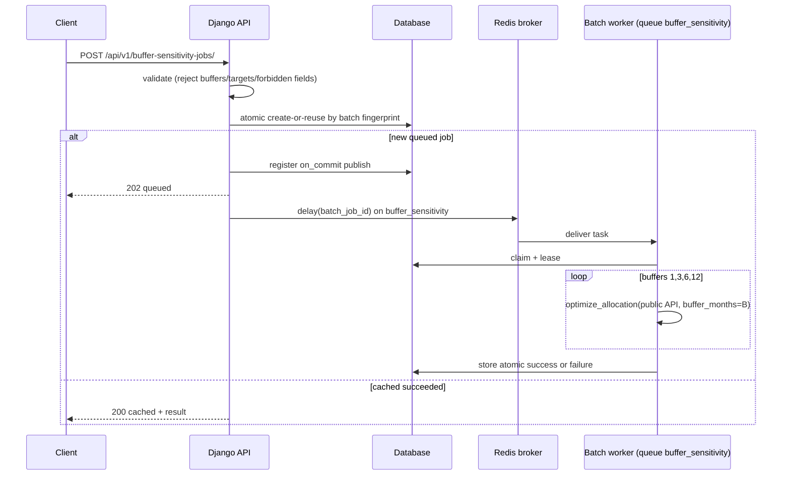
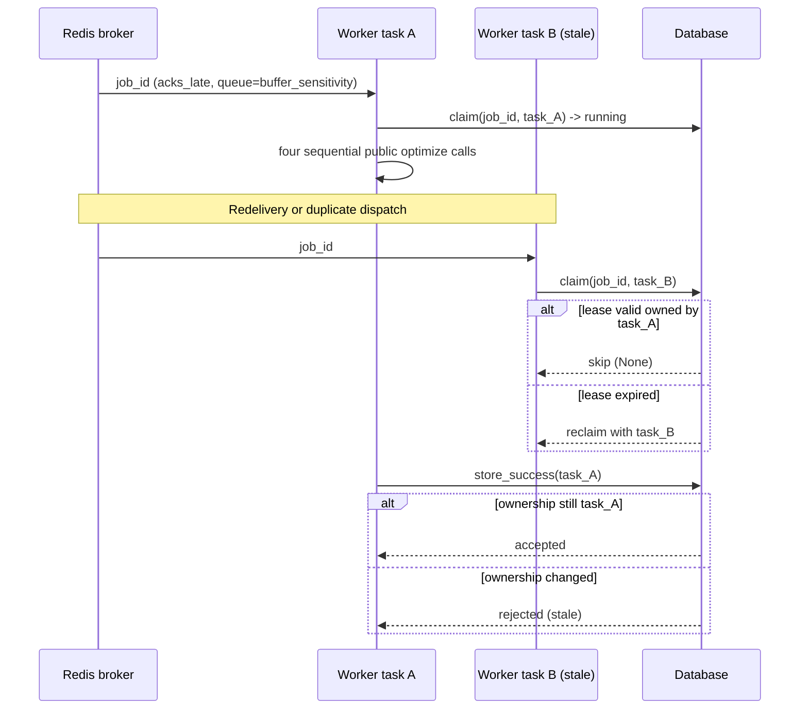

# Buffer Sensitivity Batch — Phase 3B Design & Benchmark (Hardened)

Status: **Design and engineering-feasibility only.** No production endpoints,
migrations, Celery tasks, or frontend UI were implemented in this phase.

Scientific specification: `docs/product/resilience-and-buffer-methodology.md`
Benchmark artifact: `docs/product/benchmarks/buffer-sensitivity-phase3b.json`
Probe script: `scripts/benchmarks/buffer_sensitivity_batch_probe.py`

Contract / presentation versions used in this design:

- `contract_version`: `buffer_sensitivity_batch_v1`
- `presentation_version`: `presentation_v1`

---

## 1. Executive decision

**Phase 3C decision: `GO WITH REQUIRED CHANGES`.**

| Criterion | Result |
|---|---|
| Concrete architecture for Phase 3C | **Yes** — separate `BufferSensitivityJob` + shared lifecycle helpers; dedicated Celery queue + task annotations |
| Production compute path | **Public API only** — four sequential `optimize_allocation(..., buffer_months=B)` calls; **no** `_fx_bundle` in production |
| Real measurements vs worker limits | Prior 300/360/420 batch candidates **insufficient** (P1 5y ≈ **466.6 s**). Revised candidates **600 / 720 / 840** fit with margin on this host |
| Single-job timeout risk | **Critical** — P2 5y η=1.05 `B=1` alone ≈ **125.2 s** exceeds current soft limit **120 s** |
| Canonical P2/P4 `B=1` gates | Within regression tolerances; observed values numerically identical to stored gates on this run |
| Scientific model / grid unchanged | **Yes** |
| Production API / UI implemented | **No** |
| Queue starvation addressed | **Yes** — dedicated `buffer_sensitivity` queue + concurrency-1 worker (see §10) |

**Required before Phase 3C merge:**

1. Batch task annotations (candidate **soft 600 / hard 720 / lease 840**; re-measure on deployment hardware).
2. **Single-job** task-specific limit/lease revision (candidate **soft 180 / hard 240 / lease 300**) **or** deployment-hardware proof that all advertised inputs fit 120/180/240 with margin — do **not** leave current limits unqualified; do **not** silently restrict advertised inputs.
3. Dedicated Celery queue `buffer_sensitivity` with concurrency-1 worker (production).
4. Separate submit throttle scope for batch POSTs.
5. Atomic four-buffer failure policy (§9).
6. Tests in §16.

**Product sequencing (unchanged from Phase 3A):**

1. Resilience Profile — implementable now from a single successful optimization job.
2. Buffer Sensitivity Explorer — after this batch contract is implemented.
3. Minimum tested buffer meeting a user-selected diagnostic target — derived from a **completed** batch; not a separate optimization fan-out.

---

## 2. Current architecture and constraints

Observed from the shipped codebase (not inferred):

### 2.1 Single optimization job
- Model: `calculations.OptimizationJob` — statuses `queued` / `running` / `succeeded` / `failed`; unique `request_fingerprint`; lease / `celery_task_id` / `attempt_count`.
- HTTP: `POST/GET /api/v1/optimization-jobs/` under `api/v1/`.
- Serializer accepts `profile`, `horizon_years`, optional `expense_income_ratio` (default 0.95), `buffer_months` (default 1), `rebalance_frequency` (default monthly), `conversion_cost` (default 0).
- Forbidden client fields include `n_paths`, `seed`, `_fx_bundle`, `model_version`, dataset paths, and related controls.
- Fingerprint material: normalized request + `model_version` + `dataset_sha256` + `PRODUCTION_N_PATHS` + `PRODUCTION_SEED`.
- Lifecycle: create-or-reuse with `IntegrityError` race handling; `transaction.on_commit` publish; `queue_unavailable` → HTTP 503; claim/lease/redelivery/max attempts; stale-worker result rejection when `celery_task_id` mismatches.
- Celery task `calculations.run_optimization_job` calls `optimize_allocation(...)` **without** `_fx_bundle` (each job regenerates FX).

### 2.2 Worker / throttle limits (settings defaults today)
| Setting | Default |
|---|---|
| `CELERY_TASK_SOFT_TIME_LIMIT` | 120 s |
| `CELERY_TASK_TIME_LIMIT` | 180 s |
| `OPTIMIZATION_LEASE_SECONDS` | 240 s |
| `CELERY_WORKER_CONCURRENCY` | 1 |
| `CELERY_WORKER_MAX_TASKS_PER_CHILD` | 1 |
| `CELERY_TASK_ACKS_LATE` | True |
| `CELERY_TASK_REJECT_ON_WORKER_LOST` | True |
| `optimization_submit` throttle | 3/hour |
| Documented buffers | `[1, 3, 6, 12]` |

### 2.3 Research-engine hooks (read-only)
- Module docstring: production callers use `evaluate_allocation` / `optimize_allocation`; tests may inject `_fx_bundle` **only**.
- `_fx_bundle` is a **test-only** injection. **Phase 3C production code must not call it.**
- Production paths/seed: 10,000 / 42; public calls without `_fx_bundle` always regenerate the full 5-year baseline then slice.

### 2.4 Critical finding — single-job soft limit already unsafe on this host

On the Phase 3B public-path probe, **one advertised valid single optimization** exceeded the current soft limit:

| Call | Wall s | vs soft 120 | vs hard 180 |
|---|---:|---|---|
| P2, 5y, η=1.05, monthly, cost 0, **B=1** | **125.174** | **EXCEEDS** | OK |
| P1, 5y, η=0.95, monthly, cost 0, each B | ≈ **116.4–116.7** | near ceiling | OK |

Phase 3C **must** either:

- introduce **task-specific** soft/hard limits and a corresponding lease for the existing single optimization task with `lease > hard` and `lease >= hard + safety margin`; or
- demonstrate on **deployment** hardware that all advertised valid single-job inputs fit existing 120/180/240 with adequate margin.

Do **not** silently restrict currently advertised scientific inputs. Do **not** recommend leaving single-job limits unchanged without that qualification.

### 2.5 Why a batch job is still required
Four browser POSTs conflict with `optimization_submit = 3/hour`, cannot present an atomic ordered sensitivity table, and would amplify queue load. Phase 3A already forbids naïve frontend fan-out. Batch remains a single durable fingerprint for the fixed buffer set.

---

## 3. Exact request/response contract (design only)

### 3.1 Endpoints (proposed)

```http
POST /api/v1/buffer-sensitivity-jobs/
GET  /api/v1/buffer-sensitivity-jobs/<uuid>/
```

### 3.2 POST body (JSON object)

Accepted fields only:

| Field | Required | Notes |
|---|---|---|
| `profile` | yes | P1–P4 aliases or canonical names |
| `horizon_years` | yes | `{1, 3, 5}` |
| `expense_income_ratio` | no (default 0.95) | documented values preferred in UI |
| `rebalance_frequency` | no (default `monthly`) | `{monthly, quarterly, none}` |
| `conversion_cost` | no (default `0.0`) | documented values preferred in UI |

**Server-fixed:** `tested_buffers = [1, 3, 6, 12]` always.

Clients must **not** provide buffer controls, risk targets, or engine controls (see §4).

### 3.3 Example — new job → HTTP 202

Request:

```json
{
  "profile": "P2",
  "horizon_years": 3,
  "expense_income_ratio": 0.95,
  "rebalance_frequency": "monthly",
  "conversion_cost": 0.0
}
```

Response `202`:

```json
{
  "job_id": "<uuid>",
  "status": "queued",
  "cached": false,
  "status_url": "/api/v1/buffer-sensitivity-jobs/<uuid>/",
  "contract_version": "buffer_sensitivity_batch_v1",
  "tested_buffers": [1, 3, 6, 12]
}
```

### 3.4 Example — cached success → HTTP 200

```json
{
  "job_id": "<uuid>",
  "status": "succeeded",
  "cached": true,
  "status_url": "/api/v1/buffer-sensitivity-jobs/<uuid>/",
  "contract_version": "buffer_sensitivity_batch_v1",
  "tested_buffers": [1, 3, 6, 12],
  "result": { "$ref": "structural succeeded result schema in §3.6" }
}
```

### 3.5 Poll / error examples

**Queued / running → 200:**

```json
{
  "job_id": "<uuid>",
  "status": "running",
  "created_at": "<iso8601>",
  "started_at": "<iso8601>",
  "contract_version": "buffer_sensitivity_batch_v1",
  "tested_buffers": [1, 3, 6, 12]
}
```

**Succeeded → 200:** body includes `completed_at` + `result` (§3.6).

**Failed → 200:**

```json
{
  "job_id": "<uuid>",
  "status": "failed",
  "error_code": "optimization_failed",
  "error_message": "The optimization job failed. Please retry later or contact support with the job identifier.",
  "contract_version": "buffer_sensitivity_batch_v1",
  "tested_buffers": [1, 3, 6, 12]
}
```

(Client-safe message only; never raw tracebacks.)

**Broker unavailable on POST → 503:**

```json
{
  "job_id": "<uuid>",
  "status": "failed",
  "cached": false,
  "status_url": "/api/v1/buffer-sensitivity-jobs/<uuid>/",
  "error": {
    "code": "queue_unavailable",
    "message": "The optimization queue is temporarily unavailable. Please retry shortly."
  }
}
```

**Validation → 400:** see §4 for exact body shape (aligned with current DRF envelope).

**Unknown job → 404:**

```json
{
  "error": {
    "code": "not_found",
    "message": "Buffer sensitivity job not found."
  }
}
```

**Throttle → 429:** DRF throttle response for scope `buffer_sensitivity_submit` (and poll scope as designed).

### 3.6 Succeeded `result` — structural schema (not fabricated measurements)

This schema describes shape only. Placeholders are types, not measured values.

```json
{
  "contract_version": "buffer_sensitivity_batch_v1",
  "presentation_version": "presentation_v1",
  "tested_buffers": [1, 3, 6, 12],
  "units": {
    "cumulative_shortfall": "months_of_initial_monthly_income_I0_equals_1"
  },
  "provenance": {
    "model_version": "string",
    "data_as_of": "string",
    "dataset_sha256": "hex",
    "simulation_paths": 10000,
    "simulation_seed": 42,
    "canonical_optimization_specification": "string",
    "fx_path_policy": "deterministic_regeneration_per_public_optimize_call"
  },
  "scenario": {
    "profile": "string",
    "horizon_years": "integer",
    "expense_income_ratio": "number",
    "rebalance_frequency": "string",
    "conversion_cost": "number"
  },
  "results": [
    {
      "buffer_months": "number",
      "weights": ["number", "number", "number"],
      "shortfall_probability": "number",
      "cvar95_cumulative_shortfall": "number",
      "var95_cumulative_shortfall": "number",
      "identification_class": "string",
      "near_optimal_1pct_frac": "number",
      "near_optimal_1pct_count": "integer",
      "n_coarse": "integer",
      "n_refined": "integer",
      "n_surface": "integer",
      "implementation_only": {
        "mean_cumulative_shortfall": "number",
        "wealth_depletion_probability": "number",
        "mean_terminal_wealth": "number",
        "median_terminal_wealth": "number",
        "p05_terminal_wealth": "number",
        "p95_terminal_wealth": "number"
      }
    }
  ]
}
```

Field grouping rules:

- **Published / manuscript-supported** fields stay in the normal result object: weights, shortfall probability, CVaR95, VaR95, identification / near-optimal packaging fields as today.
- **Implementation-only** fields live **only** under `implementation_only`:
  - `mean_cumulative_shortfall`
  - `wealth_depletion_probability`
  - `mean_terminal_wealth`
  - `median_terminal_wealth`
  - `p05_terminal_wealth`
  - `p95_terminal_wealth`
- Do **not** duplicate `mean_cumulative_shortfall` outside that object.
- Shared provenance appears **once** at the top level (not copied into every buffer row).
- **No** scalar Resilience Score; **no** recommended / optimal / safe / sufficient buffer.

### 3.7 Benchmark-anchored published fields (real measurements)

From artifact case `P2_3y_ei0.95_monthly_cost0`, buffer `1` only (public-path probe). These are measured outputs, not illustrative fiction:

| Field | Measured value |
|---|---|
| `weights` | `[1.0, 0.0, 0.0]` |
| `shortfall_probability` | `0.0491` |
| `cvar95_cumulative_shortfall` | `1.1871802686857733` |
| `var95_cumulative_shortfall` | `0.0` |
| `identification_class` | `A_WELL_IDENTIFIED` |

Implementation-only for that same cell (labeled; not manuscript evidence):

| Field | Measured value |
|---|---|
| `mean_cumulative_shortfall` | `0.05935901343428867` |
| `wealth_depletion_probability` | `0.0284` |
| `mean_terminal_wealth` | `9.117027760735608` |
| `median_terminal_wealth` | `7.56748856436296` |
| `p05_terminal_wealth` | `0.576860575153062` |
| `p95_terminal_wealth` | `22.64908125130461` |

Full ordered four-buffer tables: see the JSON artifact.

---

## 4. Validation rules

A strict serializer **rejects** client-supplied buffer controls and forbidden fields. It must **never** silently ignore them.

### 4.1 Reject explicitly (HTTP 400)
- `buffer_months`
- `buffers`
- `buffer_set`
- `tested_buffers`
- any arbitrary buffer list
- risk targets (`target`, `risk_target`, diagnostic thresholds, etc.)
- `n_paths`, `seed`, `_fx_bundle`, `fx_bundle`, `simulation_paths`, `simulation_seed`
- `model_version`, dataset / data path fields
- internal optimizer controls
- any other unknown key

### 4.2 Exact HTTP 400 body shape

Align with the current calculations API envelope (`calculations.exceptions.api_exception_handler`):

```json
{
  "error": {
    "code": "validation_error",
    "message": "The request could not be processed.",
    "details": {
      "forbidden_fields": [
        "Field 'buffer_months' is not allowed."
      ],
      "unknown_fields": [
        "Unknown field 'buffers'."
      ],
      "horizon_years": [
        "horizon_years must be one of [1, 3, 5]."
      ]
    }
  }
}
```

Notes:

- `forbidden_fields` / `unknown_fields` keys live under `error.details`, matching today’s single-job serializer tests.
- Field-level engine bound errors appear as named keys under `details` (DRF default).
- This design does **not** invent a new additive error envelope for existing endpoints; batch routes reuse the same handler pattern.

### 4.3 Accepted validation
Validate profile / horizon / η / rebalance / cost with the same engine bounds used today. Server always evaluates `[1, 3, 6, 12]`.

---

## 5. User-selected diagnostic target (presentation layer)

The batch **request must not** contain a risk target.

After a batch succeeds, the UI (or a pure client helper) may compute:

> **minimum tested buffer meeting a user-selected diagnostic target**

### 5.1 Eligible metrics (v1)
Published diagnostics only:

- maximum `shortfall_probability`; or
- maximum `cvar95_cumulative_shortfall`.

**Exclude** `wealth_depletion_probability` from the first finder (implementation-only).

### 5.2 Deterministic rule
1. Sort documented buffers ascending: `[1, 3, 6, 12]`.
2. Select the **first** tested buffer whose metric is ≤ the user-chosen threshold.
3. If none qualifies, show an explicit empty / not-found state.
4. Never interpolate or extrapolate between buffers.
5. Never call the value optimal, recommended, required, safe, sufficient, or advice.

### 5.3 Why the target is outside the fingerprint
Changing the user’s threshold does **not** change the four optimizations. Fingerprint the scenario + fixed buffer set + contract/model provenance only.

---

## 6. Compute sequence (production proposal)

**Production Phase 3C worker must use the supported public API only:**

1. Claim batch job (lease / task id / attempts) — same semantics as single jobs.
2. For `B` in `[1, 3, 6, 12]` **sequentially**:
   - `optimize_allocation(..., buffer_months=B)` — **no** `_fx_bundle`.
3. Assemble ordered `results`; store success atomically.
4. On any buffer failure / soft time limit: mark **whole batch failed** (see §9).

Scientific note: each public call deterministically regenerates the same production path set because paths and seed are fixed. These are **identical deterministic path sets**, not the same in-memory private bundle.

Constraints:

- Do **not** reimplement the optimizer.
- Do **not** alter `backend/research_engine/`.
- Do **not** expose a new research-engine batch method in this phase.
- Do **not** call `_fx_bundle` from production workers (test-only hook).
- Do **not** parallelize in-process optimizations in v1 (peak RSS ≈ 1.1–1.2 GiB).
- Return order is fixed ascending regardless of internal details.

**Experimental only (not production):** earlier Phase 3B shared-bundle timings via `_fx_bundle` remain an engineering curiosity. They must not be the proposed production implementation.

---

## 7. Persistence choice and alternatives

| Option | Pros | Cons |
|---|---|---|
| A. Extend `OptimizationJob` with `job_kind` | One table; shared columns | Fingerprint/payload/result schemas diverge; risk of leaking batch fields into single-job serializers; timeout annotations harder; higher regression risk |
| B. Separate `BufferSensitivityJob` | Clear schema; independent fingerprint; independent task/queue; existing optimization API untouched | Some lifecycle duplication unless helpers are shared |
| C. Generalized calculation-job abstraction | Elegant long-term | Larger 3C scope; delays explorer |

**Phase 3C choice: Option B — `BufferSensitivityJob`**, with **shared lifecycle helpers** extracted from today’s services.

Justification:

- **Migration risk:** additive new table; no change to existing job rows/URLs.
- **Lifecycle reuse:** shared helpers for claim/lease/store/on_commit/queue-unavailable.
- **Stale-worker / lease / idempotency:** same patterns on the new model.
- **Existing endpoint compatibility:** `/optimization-jobs/` unchanged.
- **Future types:** optional later generalization (Option C).

**Not implemented in Phase 3B.**

---

## 8. Fingerprinting and caching

Batch fingerprint material (SHA-256 over canonical JSON):

```text
{
  "kind": "buffer_sensitivity_batch",
  "contract_version": "buffer_sensitivity_batch_v1",
  "request": {
    "profile": <normalized canonical profile name>,
    "horizon_years": <int>,
    "expense_income_ratio": <float>,
    "rebalance_frequency": <str>,
    "conversion_cost": <float>
  },
  "tested_buffers": [1, 3, 6, 12],
  "model_version": <str>,
  "dataset_sha256": <str>,
  "simulation_paths": 10000,
  "simulation_seed": 42,
  "canonical_optimization_specification": <str>
}
```

Notes:

- `buffer_months` absent from `request` (fixed set instead).
- User diagnostic targets absent.
- One durable row per fingerprint; succeeded → HTTP 200 cached replay; failed may reset in place subject to max attempts.

---

## 9. Lifecycle, retry, lease, stale workers; atomic results

Preserve for the batch model/task:

- unique fingerprint + create race → reuse winner;
- queued reuse without duplicate dispatch (unless prior publish failed / lease expired recovery);
- failed retry in place until max attempts;
- `transaction.on_commit` broker publish;
- `queue_unavailable` on publish failure;
- worker claim with task id + lease;
- same-task redelivery handling;
- stale-worker success/failure rejection when ownership mismatches.

### 9.1 Atomic vs partial results (v1)

**Atomic:** if any buffer calculation fails, the **entire batch** is `failed`.

Rationale: an incomplete sensitivity table is not a valid comparison for the explorer or target finder.

Partial progress may be logged for operations, but must **not** be exposed as a successful `result`.

**Retry implications:** a failed batch increments `attempt_count`; retry re-runs the full four-buffer public-API sequence. Do not resume mid-buffer in v1.

---

## 10. Timeout, throttle, and queue isolation

### 10.1 Measured public-path totals (primary production measurement)

Each buffer wall time **includes** deterministic FX regeneration inside the public call. Fresh subprocess per case.

| Case | Per-buffer wall s | Total s | Peak RSS MiB |
|---|---|---:|---:|
| P2 3y η0.95 monthly cost0 | 17.9, 15.7, 15.3, 28.1 | **78.96** | 1164.7 |
| P4 3y η0.95 monthly cost0 | 15.5, 15.4, 15.8, 65.9 | **113.38** | 1192.5 |
| P2 5y η1.05 monthly cost0 | **125.2**, 38.0, 24.5, 23.0 | **211.42** | 1181.5 |
| P1 5y η0.95 monthly cost0 | 116.7, 116.4, 116.5, 116.4 | **466.55** | 1138.3 |

Comparisons vs **prior** batch candidates 300/360/420: P1 **exceeds all three**. Those candidates are **rejected**.

### 10.2 Revised batch candidates (measurement-justified)

| Limit | Candidate | Notes |
|---|---:|---|
| Soft | **600** | ≈29% headroom above observed P1 total 466.55 s |
| Hard | **720** | soft + 120 s |
| Lease | **840** | hard + 120 s; satisfies `lease > hard` and `lease >= hard + margin` |

Apply via **Celery task annotations** on the batch task only (plus batch lease setting), not by silently relying on global defaults.

Re-benchmark on deployment hardware before freezing production values.

### 10.3 Single-job candidates (required qualification)

Current 120/180/240 are **not** unconditionally safe.

| Limit | Current | Candidate annotation |
|---|---:|---:|
| Soft | 120 | **180** |
| Hard | 180 | **240** |
| Lease | 240 | **300** (≥ hard + 60 s) |

Basis: observed max single public call ≈ 125.2 s soft exceedance; P1 singles ≈ 116.7 s near the soft ceiling.

Phase 3C must encode one evidence-based choice: adopt task-specific single-job limits/lease **or** prove deployment hardware fits existing limits with margin.

### 10.4 Queue isolation (concrete Phase 3C deployment decision)

**Decision: dedicated Celery queue `buffer_sensitivity` with a concurrency-1 worker.**

Rationale:

- A multi-minute batch on the same concurrency-1 default worker starves ordinary optimization jobs (P1 batch ≈ 7.8 minutes on this host).
- Production must not share the default optimization queue with batch work.

Memory capacity:

- Measured peak RSS ≈ **1.14–1.19 GiB** per process.
- Operational allowance per worker: **≥ 2.0 GiB** RAM headroom recommendation (process + OS + broker client variance).
- Do **not** assume two optimization workers can run concurrently unless deployment memory supports both peaks (≥ ~4 GiB free for two workers alone, plus system).
- If default-queue worker and batch-queue worker co-reside on one host, provision for **two** ~1.2 GiB peaks plus margin.

Local development may use one queue for simplicity; **production behavior must use the dedicated queue**.

### 10.5 Throttle

Add scope `buffer_sensitivity_submit` (separate from `optimization_submit`).

**Conservative candidate (deployment decision, not a final production rate):** `2/hour` anonymous submit for batch POSTs; poll at a high read rate (e.g. 120/min). Final numbers need operational evidence.

---

## 11. Benchmark environment and method

- Script: `scripts/benchmarks/buffer_sensitivity_batch_probe.py`
- Interpreter: `backend/.venv`
- Isolation: one **spawned** subprocess per case
- Primary path: four sequential public `optimize_allocation` calls (no `_fx_bundle`)
- Integrity: `execution_ok`, `acceptance_ok`, `failed_checks`; process exits non-zero on failure
- Artifact: atomic temp-file replace; UTC timestamp; package versions; platform/CPU/memory metadata; probe + manifest SHA-256; relative paths only; no raw tracebacks in JSON
- Canonical matching: absolute tolerances from `backend/tests/test_research_engine_regression.py` (`cvar` abs `1e-6`, `p_short` abs `1e-4`, weights abs `1e-12`) — **tolerance-based**, not bitwise equality; artifact also reports numerical identity when it holds

Command:

```bash
cd backend
.venv/bin/python ../scripts/benchmarks/buffer_sensitivity_batch_probe.py \
  --output ../docs/product/benchmarks/buffer-sensitivity-phase3b.json
```

Acceptance self-test (temporary integrity check):

```bash
.venv/bin/python ../scripts/benchmarks/buffer_sensitivity_batch_probe.py \
  --acceptance-self-test
```

---

## 12. Benchmark results

See `docs/product/benchmarks/buffer-sensitivity-phase3b.json`.

Summary:

- All four cases: `execution_ok=true`, `acceptance_ok=true`, `failed_checks=[]`.
- Peak RSS ≈ **1.14–1.19 GiB** → concurrency remains **1** per worker.
- P1 5y public-path batch is the timing design driver (~466.6 s).
- Single-job soft-limit risk is confirmed (§2.4, §10.3).

---

## 13. Scientific equality and monotonicity checks

### 13.1 Scientific equality (gates)
Matching rule: same tolerances as the regression suite (not bitwise equality).

| Case | B=1 weights | CVaR95 | P(shortfall) | Within tol | Numerically identical to gate |
|---|---|---|---|---|---|
| P2 3y | `[1,0,0]` | `1.1871802686857733` | `0.0491` | yes | yes |
| P4 3y | `[1,0,0]` | `0.5082906243903793` | `0.0283` | yes | yes |

Shared across buffers in each batch: paths 10000, seed 42, model version, data_as_of.

### 13.2 Exploratory buffer observations (not manuscript validation)
Case-scoped probe outcomes only. Identification class is **policy metadata**, not an acceptance boolean and not a risk metric.

### 13.3 Engineering performance
Public-path totals in §10. Mean shortfall monotonicity is checked but labeled **implementation-only**.

---

## 14. Security and privacy considerations

- No new PII.
- Forbid client FX bundles / seeds / path counts / buffer lists / targets.
- Safe error messages (no absolute-path tracebacks in API or persisted probe JSON).
- Dedicated queue + separate throttle reduce batch DoS against ordinary jobs.
- Implementation-only wealth/mean fields must stay labeled if returned.

---

## 15. Backward compatibility

- Existing `/api/v1/optimization-jobs/` behavior unchanged in Phase 3B (and must remain so when batch routes land).
- Existing fingerprints, tests, and canonical regression fixtures unchanged.
- New routes are additive.
- Frontend unchanged in 3B.

---

## 16. Phase 3C test plan (specify only)

1. Strict serializer: accepted fields only.
2. Forbidden + unknown fields rejected (never silently ignored), including `buffer_months` / `buffers` / targets.
3. Fixed buffer set enforcement (`[1,3,6,12]`).
4. Fingerprint stability; distinct from single-job fingerprints.
5. Concurrent identical POSTs → one row / one dispatch.
6. Broker publish failure → 503 + `queue_unavailable`.
7. Lifecycle: redelivery, max attempts, lease expiry recovery.
8. Stale-worker success/failure discarded.
9. Succeeded schema: ordered results, shared provenance, units, versions; implementation-only grouping without duplication.
10. Atomic failure: one buffer error → batch failed, no partial success payload.
11. Canonical P2/P4 `B=1` regression inside batch (tolerance-based).
12. Public-API sequential execution (assert production worker does **not** pass `_fx_bundle`).
13. Non-increasing published shortfall metrics across buffers (optional/slow CI).
14. JSON safety of stored payload.
15. Throttle scope for batch submit.
16. HTTP views never import/call optimizer synchronously.
17. Existing optimization endpoint tests still pass unchanged.
18. Batch task routed to `buffer_sensitivity` queue in production settings.
19. Single-job and batch lease invariants: `lease > hard` and `lease >= hard + margin`.

---

## 17. Rollout and rollback plan

**Rollout:** migrate new table → deploy dedicated batch worker/queue + annotated limits (batch and single-job as decided) → enable POST/GET routes behind config flag → verify probe parity on staging → enable UI explorer.

**Rollback:** disable route flag / stop routing UI to batch; stop batch worker; single-job API remains (subject to its own limit fix).

---

## 18. Remaining risks and unresolved decisions

1. Final soft/hard/lease numbers on **production** hardware (candidates in §10).
2. Final `buffer_sensitivity_submit` rate (candidate `2/hour`).
3. Whether to return `implementation_only` wealth block in v1 API or omit until labeled UI exists.
4. Whether failed batches may later support resume-from-buffer (out of scope for v1).
5. Whether a future **supported** public research-engine helper for shared FX is warranted (out of scope; would require deliberate API design — not `_fx_bundle` promotion).
6. Author confirmation on surfacing implementation-only diagnostics (Phase 3A open item).

---

## 19. Explicit go / no-go for Phase 3C

**Decision: `GO WITH REQUIRED CHANGES`.**

Proceed to Phase 3C **only after** encoding:

1. public-API sequential compute (no production `_fx_bundle`);
2. revised batch limits/lease with `lease > hard + margin`;
3. single-job limit/lease remediation or deployment-hardware proof;
4. dedicated `buffer_sensitivity` queue + concurrency-1 worker;
5. separate submit throttle;
6. tests in §16.

Do **not** begin Phase 3C implementation in this Phase 3B hardening pass.

If deployment evidence later shows P1-class batches still exceed revised candidates, treat that as **`NO-GO pending timeout/queue redesign`** until limits or architecture are reworked — do not reduce paths, seed, horizon, grid, or buffer set to pass.

---

## Appendix A — Mermaid: new asynchronous batch submission



## Appendix B — Mermaid: cached batch response

```mermaid
sequenceDiagram
  participant UI as Client
  participant API as Django API
  participant DB as Database

  UI->>API: POST identical scenario (no buffer_months)
  API->>DB: select_for_update by fingerprint
  DB-->>API: succeeded row with result_payload
  API-->>UI: 200 status=succeeded cached=true result=...
  Note over API,UI: No broker publish; no second worker execution
```

## Appendix C — Mermaid: worker execution and stale-worker protection


